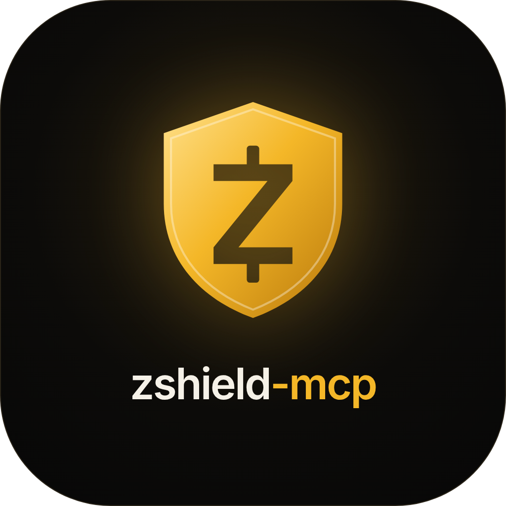
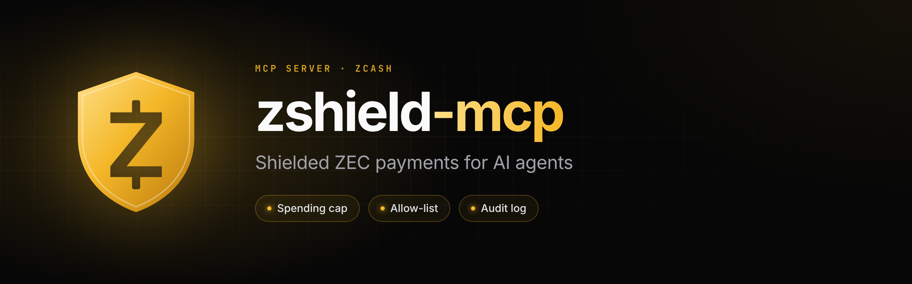
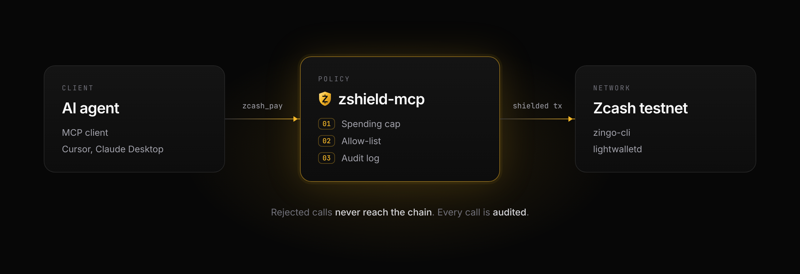
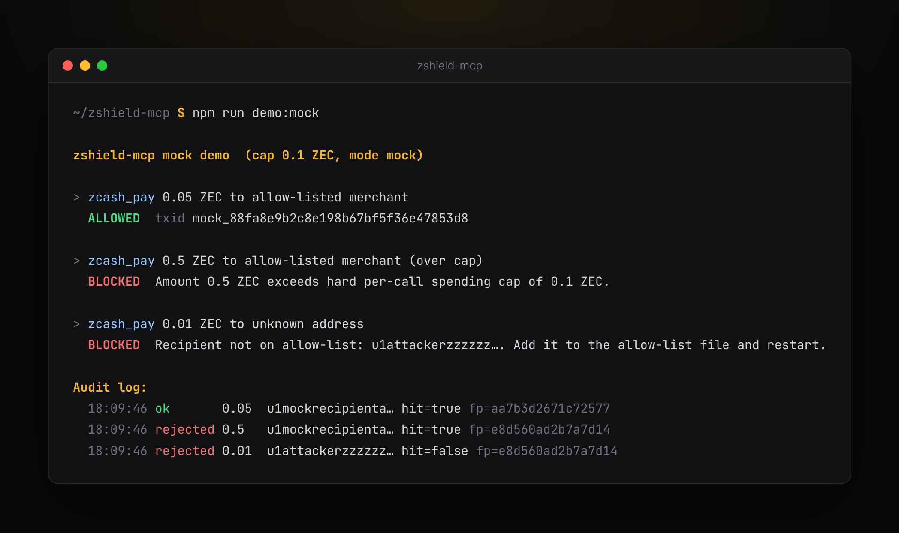
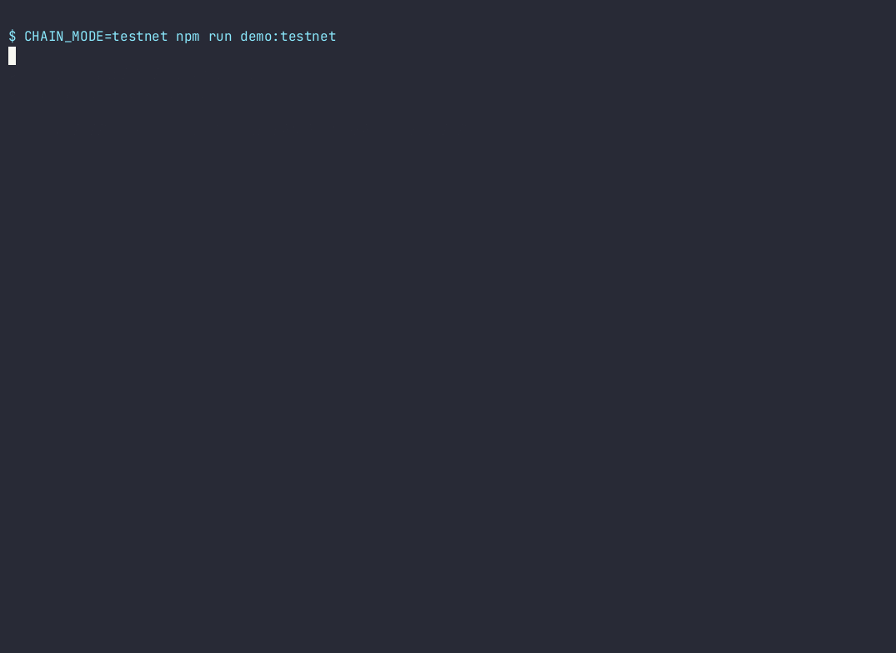

<p align="center"></p>



# zshield-mcp

[](https://mcprush.com/to/zshield-mcp?ref=badge)

**Shielded Zcash payments for AI agents, with human-defined spending controls.**

ZShield is an open-source [MCP](https://modelcontextprotocol.io/) server that lets agents request shielded ZEC payments without exposing wallet spending keys to the model. Every payment is checked against a spending cap and recipient allow-list. Payments have durable idempotency and audit records; wallet reads never move funds.

Supports a local mock wallet, real Zcash testnet payments via `zingo-cli`, and integrations with `zkool_graphql` and Ironclad FROST wallets. Mainnet is opt-in and requires additional operator controls.

> **Status:** Testnet beta. Mainnet has not been validated for production financial use. Read [production readiness](docs/PRODUCTION_READINESS.md) before using a funded wallet.



## Quickstart

**Try it locally** (Node.js 20+, no funds required):

```bash
git clone https://github.com/Steeve-Crypto/zshield-mcp.git
cd zshield-mcp
npm install
npm run build
npm run demo:mock
```



**Connect an MCP client** using the published beta package. This example runs in mock mode, so it does not send real ZEC:

```json
{
  "mcpServers": {
    "zshield": {
      "command": "npx",
      "args": ["-y", "zshield-mcp@beta"],
      "env": {
        "CHAIN_MODE": "mock",
        "SPENDING_CAP_ZEC": "0.01",
        "ALLOWLIST_PATH": "/absolute/path/to/recipients.json",
        "AUDIT_DIR": "/absolute/path/to/audits"
      }
    }
  }
}
```

Copy the [example recipient allow-list](allowlists/recipients.example.json) to the path you configured. For real testnet payments, install and fund a testnet `zingo-cli` wallet, set `CHAIN_MODE=testnet`, and configure `ZINGO_BIN`, `ZINGO_DATA_DIR`, and `VIEW_KEY_FINGERPRINT_SALT`. Use [operator controls](docs/OPERATOR_CONTROLS.md) and the [security model](docs/SECURITY_MODEL.md) before enabling live payments.

## Tools

| Tool | What it does |
| --- | --- |
| `zcash_pay` | Requests an allow-listed shielded payment within the spending cap |
| `zcash_balance` | Reads wallet balances |
| `zcash_receive_address` | Reads the wallet's receiving address |
| `zcash_history` | Lists recent wallet transactions |
| `zcash_payment_status` | Checks a payment by call, operation, or idempotency key |

Live `zcash_pay` calls require `amount_zec`, `recipient`, and a unique `idempotency_key`; `memo` is optional. An agent can also read `zshield://policy` to see the active spending policy. Payment requests can be refused; an uncertain send must be checked with `zcash_payment_status` rather than retried with a new key.

## Payment controls

- **Spending limit:** `SPENDING_CAP_ZEC` caps each call.
- **Recipient allow-list:** `ALLOWLIST_PATH` restricts destinations.
- **Audit trail:** `AUDIT_DIR` stores payment and rejection evidence.
- **Safe retries:** Durable payment state and idempotency keys guard against duplicate sends.
- **Operator protections:** Mainnet requires extra controls, including a cumulative budget and approvals.

The server cannot protect a wallet from a compromised host or an operator who grants an agent unrestricted filesystem or process access. Review the [security model](docs/SECURITY_MODEL.md) for the trust boundaries.

## Wallet integrations

| Mode | Use |
| --- | --- |
| `mock` | Local demos and tests; no real transactions |
| `testnet` | Real testnet transfers with `zingo-cli` |
| `zkool` | A configured `zkool_graphql` wallet service |
| `ironclad` | Ironclad FROST co-signer integration |
| `mainnet` | Explicit opt-in via `zingo-cli`; requires operator controls |

For advanced configuration and operational requirements, see [operator controls](docs/OPERATOR_CONTROLS.md), [reliability design](docs/RELIABILITY_DESIGN.md), and [production readiness](docs/PRODUCTION_READINESS.md).

## Testnet proof

ZShield has completed real shielded testnet payments. The animation below shows a testnet run; it is not a mainnet demonstration.



## Development

```bash
npm test
npm run typecheck
npm run build
```

Further documentation: [security](docs/SECURITY_MODEL.md) · [audit logs](docs/AUDIT.md) · [payment reliability](docs/RELIABILITY_DESIGN.md) · [operator controls](docs/OPERATOR_CONTROLS.md) · [release readiness](docs/PRODUCTION_READINESS.md)

## License

[MIT](LICENSE)
