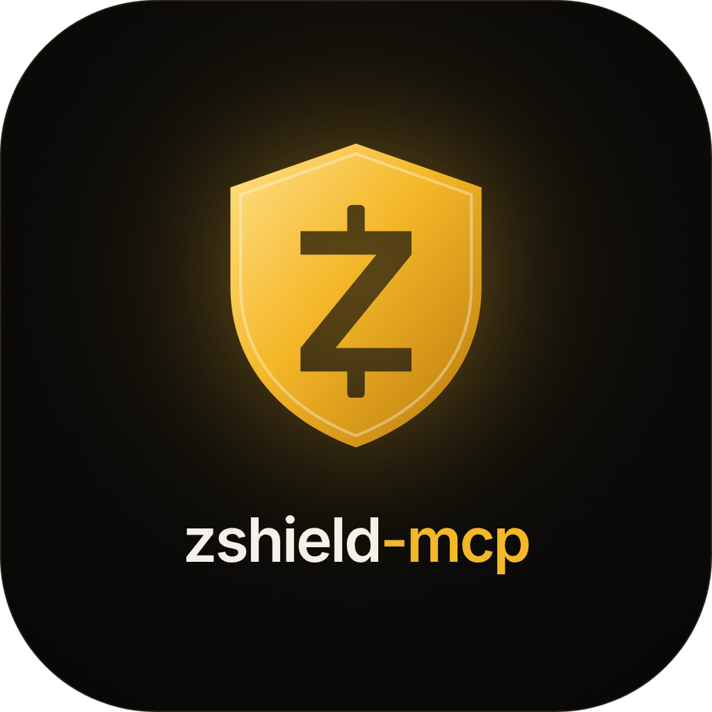
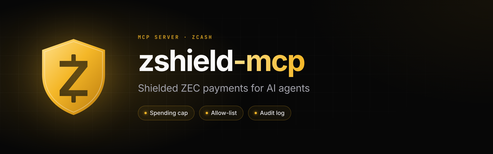
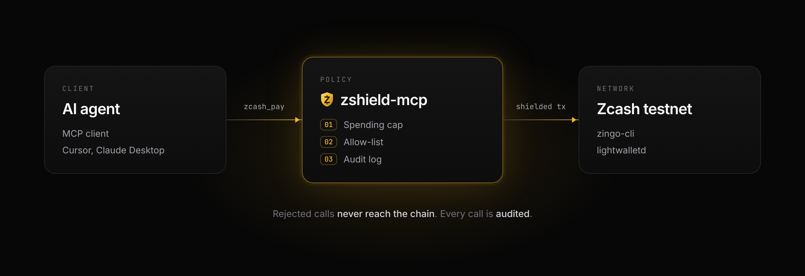
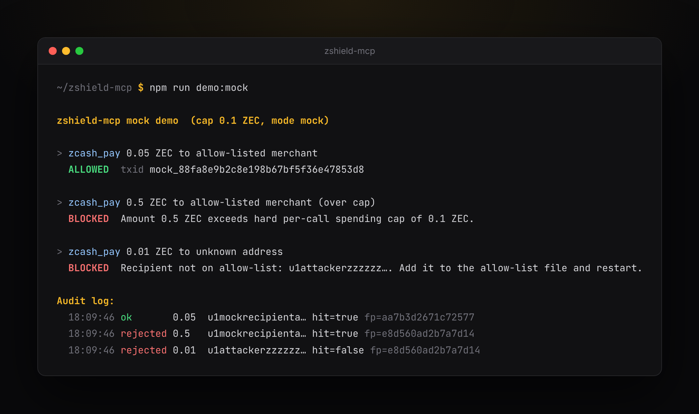
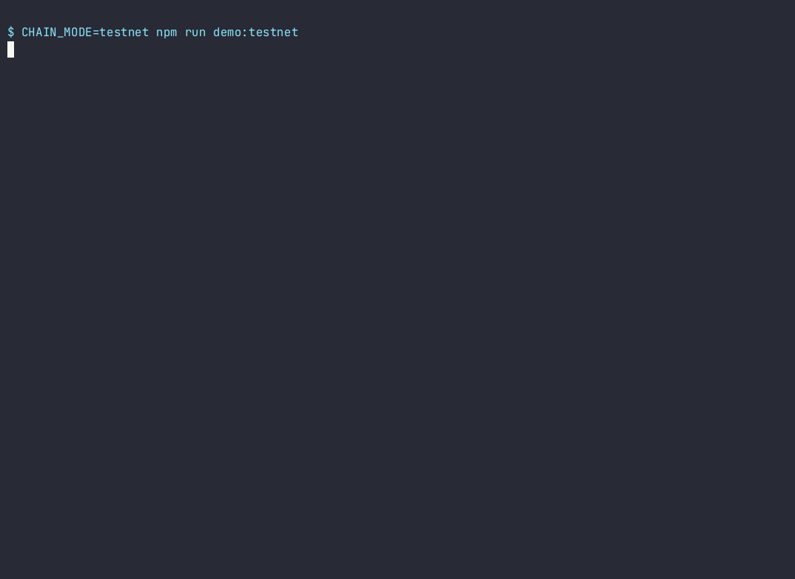

<p align="center"></p>



# zshield-mcp

Open-source **MCP server** that exposes `zcash_pay` for agent-initiated **shielded ZEC** payments under human policy, plus read-only wallet tools that never move funds. `zcash_pay` is guarded by:

- **Hard per-call spending cap**
- **Recipient allow-list**
- **Append-only viewing-key fingerprinted audit log**

Spend keys never belong in the model. Mock chain by default. A live adapter sends real shielded payments on Zcash **testnet only** through zingo-cli.



## Purpose

Agents need a payment tool they can call safely. This server enforces policy *before* any payment attempt, records an audit row for every call (success or reject), and stores only a short fingerprint in place of key material.

Built as a concrete, minimal artifact for design-partner review of shielded agent-payment MCP surfaces (see Zcash Community Grants discussions around agent payment tooling over MCP).

## Demo

Real output of `npm run demo:mock` (mock chain, no coins spent): one payment allowed, one blocked by the spending cap, one blocked by the allow-list, then the audit log.



## Quickstart

```bash
git clone <this-repo> zshield-mcp && cd zshield-mcp
cp .env.example .env
npm install
npm test
npm run typecheck   # type-checks src, tests, and scripts
npm run build
npm start   # stdio MCP server
```

Point your MCP client (Cursor, Claude Desktop, etc.) at:

```json
{
  "mcpServers": {
    "zshield": {
      "command": "node",
      "args": ["/absolute/path/to/zshield-mcp/dist/index.js"],
      "env": {
        "SPENDING_CAP_ZEC": "0.1",
        "ALLOWLIST_PATH": "/absolute/path/to/zshield-mcp/allowlists/recipients.example.json",
        "CHAIN_MODE": "mock",
        "AUDIT_DIR": "/absolute/path/to/zshield-mcp/audits"
      }
    }
  }
}
```

Or during development: `"command": "npx", "args": ["tsx", "src/index.ts"]` with `cwd` set to the repo.

## Tool: `zcash_pay`

| Arg | Type | Required | Description |
|-----|------|----------|-------------|
| `amount_zec` | string or number | yes | Decimal ZEC such as `"0.05"`, at most 8 decimals and 32 characters. Must be `> 0` and `<= SPENDING_CAP_ZEC`, compared as integer zatoshis. Never rounded |
| `recipient` | string | yes | At most 256 characters, visible ASCII only. Must exactly match an allow-list `address` |
| `memo` | string | no | Optional memo, at most 512 UTF-8 bytes (the Zcash memo size) |
| `idempotency_key` | string | live: yes. mock: no | 1 to 128 characters: letters, digits, `.`, `_`, `:`, `-`. Makes a retry safe, see below. A live payment without one is refused with `IDEMPOTENCY_KEY_REQUIRED` |

Oversized or malformed input is rejected before anything else runs. Error messages never repeat the amount text, recipient, or memo, and errors from `zingo-cli` have them replaced with `[recipient]` and `[memo]`. Each audit row is capped at 8 KiB, see [docs/AUDIT.md](docs/AUDIT.md).

### Safe retries

Pass an `idempotency_key` you choose, such as an order id. Live payments require one, so no live payment can be repeated by a retry, a restart, or a second process. The server binds it in the payment store, so it survives a restart and holds across every server process on the same wallet.

- Same key, same amount, recipient, and memo: nothing is sent again. You get the first call's result with `idempotent_replay: true` and the first `call_id`. If the first call has no result yet, you get `PAYMENT_PENDING`. If the wallet has since marked the first call's transaction failed, you get `PAYMENT_FAILED` and nothing is sent. A failed send does not reuse its key: pay again with a new one.
- Same key, anything different: `IDEMPOTENCY_CONFLICT`. Nothing is sent.
- A key only counts as used once it is bound, right before the send. A call refused before that (cap, allow-list, `BUSY`, a health check) does not use it up.

The payment store is a folder, `.zshield-state`, inside the wallet directory (beside `AUDIT_DIR` in mock mode). Every server process on one wallet finds the same store, whatever its `AUDIT_DIR` or working directory. Idempotency, status, and recovery read the store; the audit log stays the human trail. The first time a server opens the store with a given `AUDIT_DIR`, it imports the payments in that audit log once. That takes about 15 seconds per 20,000 rows. See [docs/RELIABILITY_DESIGN.md](docs/RELIABILITY_DESIGN.md).

Other protections on every send:

- **No two wallet holders, ever.** Every `zingo-cli` process the server starts (sync, reads, send, transmit) goes through a small `perl` wrapper that takes an exclusive `flock` on `.zshield-state/zingo.flock` and then runs `zingo-cli`, which inherits the lock. A frozen, killed, or late server process cannot start a second wallet process beside a running one, whatever the payment keys are. A send also carries a start deadline: if it waited for the wallet past it, it is not started. This needs `perl` and a POSIX platform; without them live mode refuses to run, so Windows is not supported for live use.
- **One send at a time per wallet, across processes.** A second call waits up to `SEND_QUEUE_WAIT_MS` for the first to finish, then gets `BUSY`. The lock is a lease file, `.zshield-state/wallet.lock`, so two server processes on one wallet take turns too. It is created with mode 0600 and holds the owner's pid, host, start time, purpose, a random token, its lease time, and a renewal counter. The holder renews it every quarter of `ZSHIELD_LOCK_LEASE_MS` (default 60 seconds). A lock whose process died, or that has not been renewed for the longer of the holder's lease time and the caller's own, is removed by the next caller, and only after it re-reads the exact content and still finds it stale, so a live holder is never broken into. Right before binding the key, right before the send, and at the moment `zingo-cli` starts, the holder checks that the lock is still its own and was renewed on time. If not, it stops with `BUSY` and sends nothing. Under the lock the server also re-reads the key, so a key used by another process is replayed instead of paid again. The lease decides which server process may start a send; the OS lock above keeps the wallet processes apart. Staleness is judged by the file's modification time, so all processes on one wallet should share a clock: the same host, or a network share with a sane clock.
- **Two-stage send, exact memo.** A live send first builds and signs the transaction (`send` and `calculate`, nothing is broadcast), records its txid on the call, and only then runs `transmit <txid>`. A timeout or crash during the broadcast therefore leaves the call's own txid on record, and recovery asks the wallet about that txid. The memo is checked once and is exact: no trimming, no control characters, no leading or trailing whitespace, at most 512 UTF-8 bytes, and an empty memo means no memo. The same string is what policy checks, the audit row and intent hold, and what is sent.
- **Health check first (testnet mode).** Before the `pending` row, the server syncs the wallet for at most `HEALTH_SYNC_TIMEOUT_MS`, then checks that the lightwalletd server answers, the wallet is within `HEALTH_MAX_LAG_BLOCKS` of the chain tip, and spendable funds cover the amount plus a 0.0001 ZEC fee estimate. A failure returns `CHAIN_UNREACHABLE`, `WALLET_NOT_SYNCED`, or `INSUFFICIENT_FUNDS` and sends nothing. A wallet whose sync has not finished can report a spendable balance of 0, so low funds after an unfinished sync are `WALLET_NOT_SYNCED`, not `INSUFFICIENT_FUNDS`.
- **Recovery on startup.** If the server stopped between the `pending` row and the result row, the next start looks for the send in wallet history. A transaction counts only if the recipient (or its unified address), the amount, and the memo are all equal, and it is placed after the call started by its time or its block height. A call with no memo never matches someone else's memo payment, and a call that had no memo is never confirmed from history by a lone match: it stays `unknown` with the candidate listed. A call with a recorded txid is settled by that txid alone. History entries are also checked against `zingo-cli`'s JSON (`notes all`, `coins all`, `messages`), and an entry the JSON does not vouch for never confirms a call. Identical calls started close together stay `unknown`. It reads the whole history, never a recent slice, and writes one `zcash_pay_recovery` row: `confirmed` with the txid, `not_found` only with proof, or `unknown`. Proof means the wallet is synced, the whole history was read, the server's tip agrees with the wallet and has not gone backwards, the wallet has scanned more than 70 blocks past the height recorded before the send (the 40 block expiry plus a margin), and at least two hours have passed. A send is refused up front when the server's tip is below the wallet's own height or below a tip it reported before. Each run handles at most 100 calls within a time budget and leaves the rest for the next start. States only move forward: a call once seen as sent or mined never goes back. It never sends again. It holds the wallet lock while it runs and syncs first, for at most `STATUS_SYNC_TIMEOUT_MS`, so a payment made right after startup waits for it and may get `BUSY`. `unknown` ones are checked again on the next start.

## Resource: `zshield://policy`

Read this before paying to see the rules the server will apply. It is JSON, built fresh on every request. It never shows a local path. Reads count against `RATE_LIMIT_PER_MIN` like tool calls, and the allow-list behind it is cached until the file changes:

```json
{
  "mode": "mock",
  "chain_adapter": "mock",
  "mainnet": "refused",
  "limits": {
    "per_call_cap_zec": "0.1",
    "per_call_cap_zats": "10000000",
    "daily_or_rolling_cap": "none",
    "amount_unit": "integer zatoshis, 1 ZEC = 100000000",
    "max_decimals": 8,
    "tool_calls_per_min": 60
  },
  "allowlist": {
    "size": 2,
    "match": "exact address string"
  },
  "audit": {
    "every_call_audited": true,
    "pending_row_before_send": true,
    "rate_limited_calls": "not audited one by one; counted in one summary row per minute"
  },
  "tools": {
    "payment": ["zcash_pay"],
    "read_only": ["zcash_balance", "zcash_receive_address", "zcash_history", "zcash_payment_status"]
  }
}
```

`mode` is `mock` or `testnet`. `size` counts unique addresses in the allow-list file right now. If the file cannot be read, `size` is `null`, `error` says why, and every `zcash_pay` call is rejected until it is fixed. The cap is per call only; there is no daily or rolling limit yet. The fingerprint salt is never shown.

### Rejection codes

Every failed `zcash_pay` call returns `isError: true` and a body like this:

```json
{
  "ok": false,
  "status": "rejected",
  "code": "CAP_EXCEEDED",
  "message": "Amount 0.5 ZEC exceeds hard per-call spending cap of 0.1 ZEC.",
  "error": "Amount 0.5 ZEC exceeds hard per-call spending cap of 0.1 ZEC."
}
```

Branch on `code`. It is stable. `message` is for people and may change. `error` holds the same text as `message` for older clients. The audit row for the call records the same `code`.

`status` is `rejected` when policy refused the call. Nothing was sent and there is no `pending` row.

| Code | Meaning |
|------|---------|
| `INVALID_RECIPIENT` | Recipient is empty, longer than 256 characters, or has characters that cannot appear in an address. The value is not repeated in the message |
| `INVALID_MEMO` | Memo is longer than 512 UTF-8 bytes, or has a control or line-break character. A memo is one line of text |
| `INVALID_AMOUNT` | Amount is not a positive decimal with at most 8 decimals, or is above the 21,000,000 ZEC supply |
| `CAP_EXCEEDED` | Amount is above `SPENDING_CAP_ZEC` |
| `INVALID_CAP` | The configured cap itself is not valid, so every payment is refused |
| `MAINNET_REFUSED` | Testnet mode got a mainnet address (`u1`, `zs1`, `t1`, `t3`, `zc`). Refused even if it is on the allow-list |
| `INVALID_ADDRESS` | Testnet mode got an address from no known Zcash network |
| `NOT_ALLOWLISTED` | Recipient is not an exact match for an allow-list entry |
| `ALLOWLIST_UNAVAILABLE` | The allow-list file is missing or malformed, so every payment is refused |
| `INVALID_IDEMPOTENCY_KEY` | `idempotency_key` is empty, longer than 128 characters, or has characters other than letters, digits, `.`, `_`, `:`, `-` |
| `IDEMPOTENCY_KEY_REQUIRED` | A live payment was called without an `idempotency_key`. Nothing is sent. Choose a key such as an order id and call again |
| `IDEMPOTENCY_CONFLICT` | `idempotency_key` was already used for a payment with a different amount, recipient, or memo |

`status` is `error` when something failed outside policy:

| Code | Meaning |
|------|---------|
| `AUDIT_WRITE_FAILED` | The `pending` audit row could not be written, so the payment was not sent |
| `VIEWKEY_UNAVAILABLE` | The wallet's viewing key could not be read for the audit fingerprint, so the payment was not sent |
| `CHAIN_ERROR` | Policy passed and the send was attempted, but `zingo-cli` reported an error, so nothing was broadcast. A `pending` row exists |
| `BUSY` | Another payment, sync, or recovery on the same wallet, in this process or another one, was still running after `SEND_QUEUE_WAIT_MS`. The message names the other process's pid when it is another process. Nothing was sent and there is no `pending` row. Try again shortly |
| `WALLET_NOT_SYNCED` | Testnet mode: the wallet is more than `HEALTH_MAX_LAG_BLOCKS` blocks behind the chain tip, or the pre-send sync did not finish and the spendable balance reads below the amount. Nothing was sent. Try again once the wallet has synced, or raise `HEALTH_SYNC_TIMEOUT_MS` |
| `INSUFFICIENT_FUNDS` | Testnet mode: spendable balance is below the amount plus the estimated fee. Nothing was sent |
| `CHAIN_UNREACHABLE` | Testnet mode: the lightwalletd server did not report the chain tip within `ZINGO_HEALTH_TIMEOUT_MS`. Nothing was sent |
| `CONFIG_ERROR` | The server is misconfigured, for example testnet mode without the testnet adapter. Nothing was sent |
| `STATE_WRITE_FAILED` | The payment store in the wallet dir could not be opened or written before the send, so the payment was not sent |
| `PAYMENT_EXPIRED` | A repeat call whose first call was proven never sent: the synced wallet scanned its whole history past the expiry height and found no match. Pay with a new idempotency key |
| `PAYMENT_FAILED` | A repeat call whose first call returned a txid that the wallet has since marked failed. Nothing is sent again, and the key stays bound to that failed send. Check the explorer, then pay with a new idempotency key |

`status` is `unknown` when the send was started but its result is not known:

| Code | Meaning |
|------|---------|
| `SEND_UNCONFIRMED` | `zingo-cli` timed out, was killed, or finished without a txid or an error. The payment may have been broadcast. Do not pay again: call `zcash_payment_status` with the `call_id`, which reports `expired` only once the payment is proven never sent. The response and the audit row list `possible_sends`, sent transactions in the whole wallet history to the same recipient with the same amount (and memo, when one was given) found right after the failure, each with a `confidence`. `possible_txids` holds just their txids. Amount alone never counts as a match. An empty list does not prove nothing went out, because the wallet may not have synced the send yet |
| `PAYMENT_PENDING` | A repeat call with an `idempotency_key` whose first call has a `pending` row and no result yet. Nothing was sent again. Call `zcash_payment_status` with the key |

Checks run in this order, and the first failure decides the code: recipient and memo size, allow-list file, amount, cap, address network (testnet mode only), allow-list match.

Any tool call over the rate limit is refused before the tool runs:

| Code | Meaning |
|------|---------|
| `RATE_LIMITED` | More than `RATE_LIMIT_PER_MIN` tool calls this minute in this server process. Nothing was sent or read. Wait and try again. These calls get no audit row each; their count goes into one summary row per minute |

Read-only tools use the same shape. `zcash_history` returns `INVALID_LIMIT` with status `rejected` for a bad `limit`. A wallet read failure is `CHAIN_ERROR`, and a wallet that reports a mainnet address is `MAINNET_REFUSED`. `zcash_payment_status` returns `INVALID_LOOKUP` unless exactly one of `call_id` or `idempotency_key` is given, and `PAYMENT_NOT_FOUND` when the wallet's payment store has no such call.

## Read-only tools

These tools never send anything. Each call writes one audit row with the tool name, mode, and outcome. The row does not hold balances, addresses, or transaction data. If that row cannot be written, the tool still answers and adds an `audit_warning`, since nothing moved.

### `zcash_balance`

No arguments. Returns the wallet balance in integer zatoshis and as a ZEC string:

```json
{
  "ok": true,
  "mode": "mock",
  "confirmed_zats": "1000000000",
  "confirmed_zec": "10",
  "spendable_zats": "1000000000",
  "spendable_zec": "10",
  "unconfirmed_zats": "0",
  "unconfirmed_zec": "0"
}
```

Zatoshi values are strings so they stay exact in JSON. `confirmed` is the sum of confirmed funds across every pool. `spendable` is what the wallet can send right now. In testnet mode the values come from `zingo-cli balance` and `zingo-cli spendable_balance`, as of the wallet's last sync.

In mock mode the wallet starts with 10 ZEC. Each mock payment takes the amount plus a 0.0001 ZEC fee, and a payment larger than the balance fails with an insufficient funds error.

### `zcash_receive_address`

No arguments. Returns the wallet's current unified address, which is the newest one on account 0:

```json
{
  "ok": true,
  "mode": "live",
  "address": "utest14dsty0x36s…",
  "network": "testnet"
}
```

In testnet mode it comes from `zingo-cli addresses`, and a mainnet address is refused. In mock mode it is a fixed fake address that starts with `u1mockwallet`.

### `zcash_history`

| Arg | Type | Required | Description |
|-----|------|----------|-------------|
| `limit` | integer | no | How many recent transactions to return. Default `10`, allowed `1` to `50` |

Returns recent transactions, newest first. Ones that are not confirmed yet come first.

`status` is what `zingo-cli` reports. `confirmed` means mined, and `block_height` is the block it was mined in. `transmitted` means the wallet sent it but has not seen it in a block yet, which can simply mean the wallet has not synced that far. `mempool` and `calculated` are also not mined yet. `failed` means it expired or was rejected without being mined, so its funds are spendable again. For anything not confirmed, `block_height` is absent and `target_height` is the height it was built for. It expires unmined about 40 blocks after that.

```json
{
  "ok": true,
  "mode": "live",
  "count": 1,
  "transactions": [
    {
      "txid": "59d9cb1b5a47…",
      "time": "2026-10-13T00:52:06.000Z",
      "status": "confirmed",
      "block_height": 4493943,
      "kind": "sent",
      "value_zats": "100000",
      "value_zec": "0.001",
      "fee_zats": "10000",
      "explorer_url": "https://blockexplorer.one/zcash/testnet/tx/59d9cb1b5a47…"
    }
  ]
}
```

A limit outside `1` to `50`, or one that is not a whole number, is rejected before the wallet is asked, and the rejection is audited. Memos and counterparties are not returned. In testnet mode the list comes from `zingo-cli transactions`. In mock mode it lists the mock funding receive and every mock payment made in this server session.

### `zcash_payment_status`

| Arg | Type | Required | Description |
|-----|------|----------|-------------|
| `call_id` | string | one of the two | The `call_id` from a `zcash_pay` response |
| `idempotency_key` | string | one of the two | The key passed to `zcash_pay` |

Looks the call up in the payment store, then in the whole wallet history. Never sends. In testnet mode it first syncs the wallet for at most `STATUS_SYNC_TIMEOUT_MS`, so a payment mined since the last sync shows as `mined` without any manual step. If the sync does not finish, or a send holds the wallet, it does not wait: it answers from what the wallet last knew, with `stale: true`, `wallet_height`, and a `sync_note` saying why.

```json
{
  "ok": true,
  "mode": "live",
  "call_id": "3f0c…",
  "idempotency_key": "order-7",
  "state": "mined",
  "txid": "59d9cb1b5a47…",
  "block_height": 4493943,
  "confirmations": 12,
  "wallet_height": 4493954,
  "amount_zats": "10000",
  "message": "Mined at height 4493943.",
  "explorer_url": "https://blockexplorer.one/zcash/testnet/tx/59d9cb1b5a47…"
}
```

| `state` | Meaning |
|---------|---------|
| `pending` | Started and no outcome yet: being sent now, or interrupted and not found in history so far |
| `broadcast` | Sent, not mined yet |
| `mined` | In a block. `confirmations` counts from the wallet's synced height |
| `expired` | Proven never sent: not in the whole history of a synced wallet that has scanned past the expiry height. Safe to pay again with a new key |
| `failed` | Not sent (refused or errored, `code` says why), or the wallet marks the transaction failed (`PAYMENT_FAILED`, with its `txid`). The failed record stays unless the transaction is later seen mined |
| `unknown` | Cannot tell, for example two matching sends or history that could not be read. `possible_sends` lists candidates |

## Config: caps & allow-list

Precedence: **environment variables** override `config/default.yaml`.

| Variable | Default | Meaning |
|----------|---------|---------|
| `SPENDING_CAP_ZEC` | `0.1` | Hard max ZEC **per tool call**, positive with at most 8 decimals |
| `ALLOWLIST_PATH` | `./allowlists/recipients.example.json` | JSON allow-list |
| `CHAIN_MODE` | `mock` | `mock` or `testnet` (any other live value exits) |
| `AUDIT_DIR` | `./audits` | JSONL audit directory |
| `VIEW_KEY_FINGERPRINT_SALT` | from yaml | Salt for view-key fingerprints |
| `RATE_LIMIT_PER_MIN` | `60` | Tool calls allowed per minute across all tools in one server process, 1 to 10000. Calls over it get `RATE_LIMITED` |
| `AUDIT_FALLBACK_PATH` | `audit-fallback.jsonl` next to `AUDIT_DIR` | Where an audit row goes when the main log cannot be written |
| `SEND_QUEUE_WAIT_MS` | `10000` | How long a send waits for another send from the same wallet, up to `600000`, before `BUSY` |
| `HEALTH_MAX_LAG_BLOCKS` | `10` | Testnet mode: how far the wallet may trail the chain tip and still send, 0 to 10000 |
| `HEALTH_SYNC_TIMEOUT_MS` | `90000` | Testnet mode: the longest the pre-send wallet sync may run, 0 to 600000. `0` skips it |
| `STATUS_SYNC_TIMEOUT_MS` | `90000` | Testnet mode: the longest the wallet sync before `zcash_payment_status` and startup recovery may run, 0 to 600000. `0` skips it |
| `ZSHIELD_LOCK_LEASE_MS` | `60000` | How long a wallet lock lives without a renewal, 1000 to 600000 |

A timeout or lease outside its range stops the server at startup instead of being clamped.

Allow-list shape:

```json
{
  "recipients": [
    { "address": "u1…", "label": "Demo merchant" }
  ]
}
```

## Audit log format

JSONL per day: `audits/YYYY-MM-DD.jsonl`. A call that passes policy writes a `pending` row before the chain send and a result row after it, linked by `call_id`. Each row is flushed to disk (fsync) before the server moves on, so the `pending` row exists before anything is sent. If the main log cannot be written, the row goes to the fallback file; if neither works, the payment is refused with `AUDIT_WRITE_FAILED`. A rejected call writes one `rejected` row. A repeat with a used `idempotency_key` writes a `replayed` row, and startup recovery writes `zcash_pay_recovery` rows. Example success line:

```json
{"ts":"2026-10-05T19:00:00.000Z","tool":"zcash_pay","call_id":"3f0c…","amount_zec":0.05,"amount_zats":"5000000","recipient":"u1…","allowlist_hit":true,"cap_zec":0.1,"status":"ok","mock_txid":"mock_…","view_key_fingerprint":"a1b2c3d4e5f60718","memo":"test"}
```

The viewing key itself is **never** written or returned, only a short fingerprint of it. `view_key_fingerprint` is the first 16 hex characters of `sha256(salt | UFVK)`, where UFVK is the wallet's unified full viewing key. In testnet mode the server reads it once per process with `zingo-cli export_ufvk` in an offline session and keeps it in memory. Mock mode uses a fixed fake key. Every row from one wallet carries the same fingerprint, so anyone holding the UFVK and the salt can confirm which wallet wrote a log, then match each row to the chain by its txid. The tool response includes the same `call_id` as the audit rows. See [docs/AUDIT.md](docs/AUDIT.md) and [docs/SECURITY_MODEL.md](docs/SECURITY_MODEL.md).

## Security model

[docs/RELIABILITY_DESIGN.md](docs/RELIABILITY_DESIGN.md) explains how one request leads to at most one send, and [docs/V12_CHECKLIST.md](docs/V12_CHECKLIST.md) lists every review note with its status and test. [docs/SECURITY_MODEL.md](docs/SECURITY_MODEL.md) covers where keys live, what the server can and cannot do, the trust boundaries, threats and mitigations, and what is out of scope. Read it before pointing this at a funded wallet. The short version: the cap is per call only, so many small payments can still drain the wallet, and the audit log is not tamper-evident.

## Layout

```
src/policy/   caps + allow-list
src/chain/    mock adapter, testnet adapter, address checks
src/audit/    JSONL writer + fingerprint
src/payments/ idempotency index, send lock and wallet lock file, startup recovery
src/chain/sync.ts bounded wallet sync through the zingo-cli prompt
src/tools/    zcash_pay and the read-only tools
src/server.ts MCP registration
tests/        happy path + rejections
```

## Testnet mode

What it does: with `CHAIN_MODE=testnet` the server checks cap, allow-list, and address network first, writes the audit row, and only then calls `zingo-cli quicksend` against a public testnet lightwalletd (default `https://testnet.zec.rocks:443`). Mainnet addresses (`u1`, `zs1`, `t1`) are rejected; testnet ones (`utest`, `ztestsapling`, `tm`) are accepted. `CHAIN_MODE=live` alone is refused.

Setup:

```bash
# build zingo-cli (Rust)
git clone https://github.com/zingolabs/zingolib && cd zingolib
# the parsers were checked against the command source of this revision
git checkout 181a91103b93e7155017d4a05af0722b013b774e
cargo build --release -p zingo-cli
# create a fresh testnet wallet outside the repo and print its address
zingo-cli --chain testnet --server https://testnet.zec.rocks:443 \
  --data-dir ~/.zshield-testnet/wallet addresses
```

Fund that address with TAZ from a testnet faucet such as https://faucet.testnet.valargroup.dev (API claim) or https://zcashfaucet.jinolabs.xyz and wait for it to confirm. Keep `~/.zshield-testnet/` private; it holds the wallet seed and is never inside the repo. `zingo-cli` creates the wallet with your default umask, which usually leaves it readable by other users, so lock it down:

```bash
chmod 700 ~/.zshield-testnet ~/.zshield-testnet/wallet
chmod 600 ~/.zshield-testnet/wallet/*
```

In testnet mode the server checks this at startup. If the wallet directory is open to group or other users, it prints each path with its mode and the fix, then exits with status 1 instead of serving. A loose file mode inside a private directory only gets a warning, because nobody else can reach that file and `zingo-cli` recreates the wallet file with your umask every time it saves. To keep the file at `600`, the server sets its umask to `077` in testnet mode, which also covers the `zingo-cli` runs it starts and the audit files it writes.

Run the MCP server in testnet mode:

```bash
CHAIN_MODE=testnet ZINGO_BIN=$(which zingo-cli) \
ZINGO_DATA_DIR=~/.zshield-testnet/wallet \
ALLOWLIST_PATH=./allowlists/testnet.json npm start
```

Optional variables:

- `ZINGO_BIN`: path to `zingo-cli`.
- `ZINGO_DATA_DIR`: the wallet directory. It must be an absolute path. The default is `.zshield-testnet/wallet` in the home directory the OS reports, not `$HOME`, and the server will not start if that cannot be found.
- `LIGHTWALLETD_URL`: the testnet server. A URL with a user, password, query string, or fragment is refused at startup, because `zingo-cli` takes the server only on its command line, where other local users can read it. Set `ZSHIELD_ALLOW_URL_CREDENTIALS=1` to accept that risk. The server then hides those parts in every response, error, and audit row, but not from the process list.
- `ZINGO_READ_TIMEOUT_MS` (default `120000`, 1 to 600000): stops a read-only call that takes too long.
- `ZINGO_HEALTH_TIMEOUT_MS` (default `30000`, 1 to 300000): stops each pre-send health check step after the sync.

The read-only tools never wait for the wallet. When a send or sync holds it, `zcash_balance`, `zcash_history`, and `zcash_receive_address` read the wallet file offline, as last synced, instead of starting a sync that would race the send.

At startup the server also checks the audit dir, the fallback file, and the payment store: it refuses a symlink or a path owned by another user, and tightens group or other access to `700` for folders and `600` for files. On Windows it reads the ACL of the wallet directory, the wallet file, the payment store, and the audit dir with `icacls` and refuses to run if Everyone, Users, or another broad group can read them. Set `ZSHIELD_HARDEN_WINDOWS_ACL=1` to have it remove inherited entries and grant only your account, or `ZSHIELD_ALLOW_UNCHECKED_WINDOWS_ACL=1` to start anyway when the ACL cannot be read.

Run the demo:

```bash
npm run demo:testnet
```

The demo creates a second fresh testnet wallet as the recipient, writes a one-entry allow-list for it, and sends 0.001 TAZ through `executePay`, the same policy path the `zcash_pay` tool uses. It uses the idempotency key in `DEMO_KEY`, or a fresh `demo-<time>` key, since live payments need one. It prints the txid and a link on https://blockexplorer.one/zcash/testnet. A confirmed txid proves the full path works end to end: policy checks, audit write, and a real shielded transaction on the Zcash testnet.

To use another zingolib revision, build it and run `npm test`, then a testnet payment, before trusting its output: the server parses `transactions`, `notes all`, `coins all`, `messages`, `info`, `height`, `export_ufvk`, and the `send`, `calculate` and `transmit` replies, and treats anything it cannot parse as unknown, never as sent or not sent. `perl` must be on the `PATH`.

## Proof: live testnet payment

One real shielded 0.001 TAZ payment through `zcash_pay`, plus a blocked over-cap attempt: [tx 59d9cb1b5a47... on blockexplorer.one](https://blockexplorer.one/zcash/testnet/tx/59d9cb1b5a473a84602c4812a7809217f6e9d359174deb178e7fd52c151ae8fc)



## Status and non-goals

- ✅ Mock payments, policy enforcement, audit
- ✅ Testnet shielded sends via zingo-cli
- ✅ Read-only balance, receive address, and history tools
- ✅ Stable rejection codes
- ✅ Idempotency keys (required for live payments), an OS-level wallet lock, a two-stage send with the txid recorded before broadcast, one send at a time per wallet, pre-send health check, startup recovery, and `zcash_payment_status`
- ❌ Daily or rolling spend limits (per call only for now)
- ✅ Audit fingerprint from the wallet's real viewing key (UFVK)
- ❌ Mainnet (refused by design)
- ❌ Custody of user spend keys

## License

MIT
