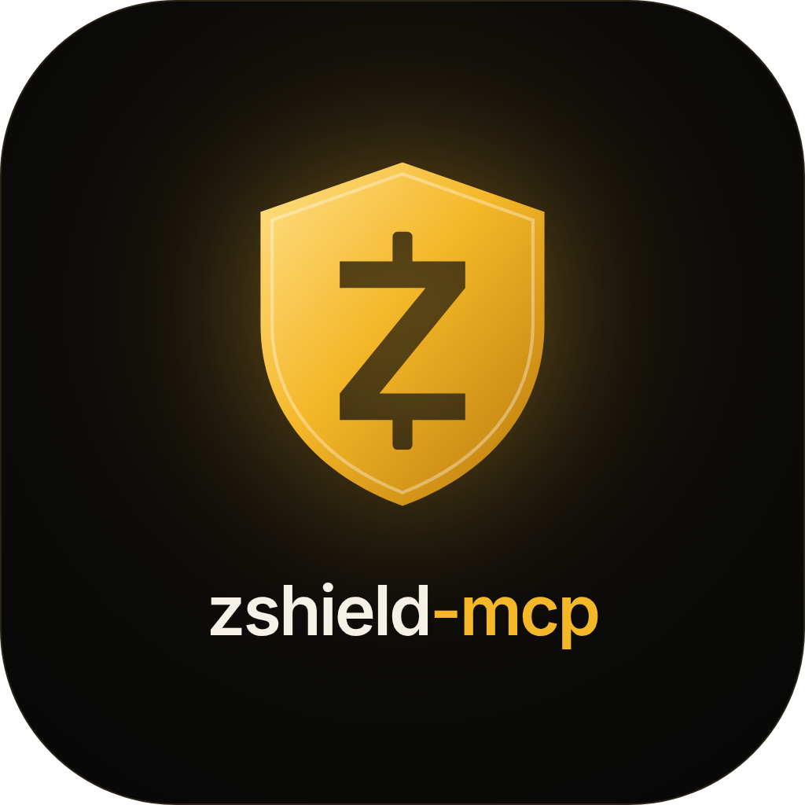
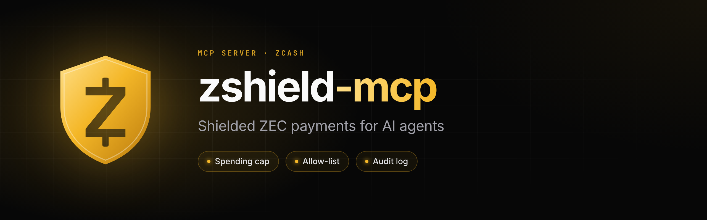
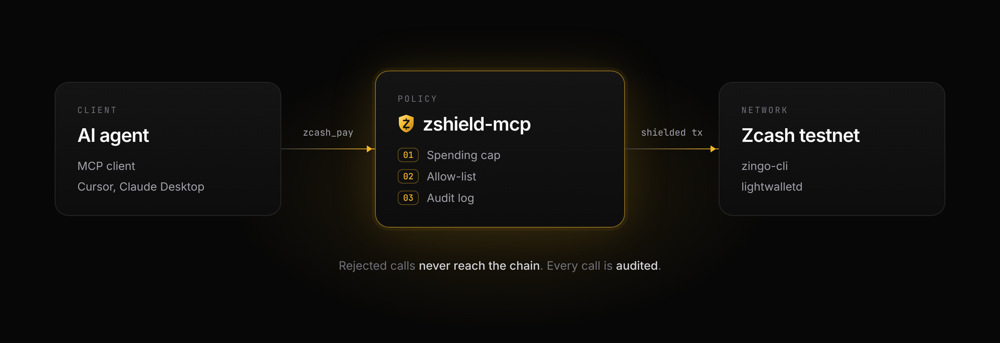
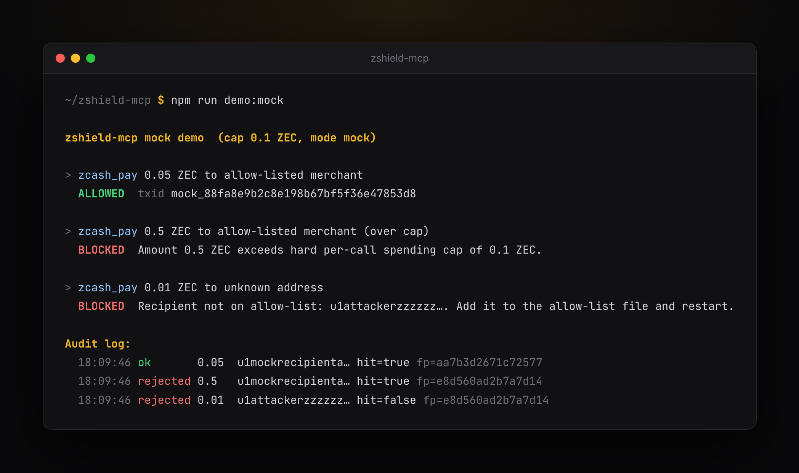
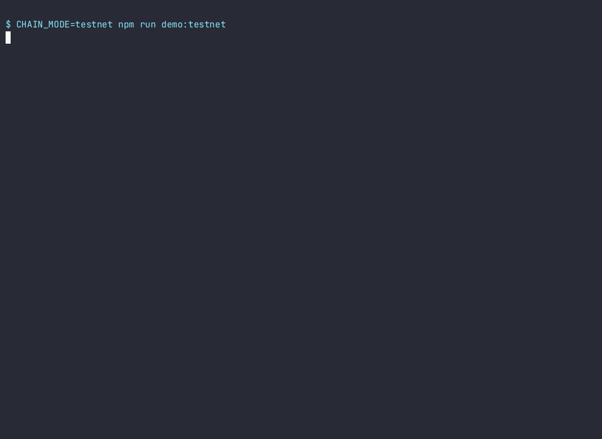

<p align="center"></p>



# zshield-mcp

Open-source **MCP server** that exposes `zcash_pay` for agent-initiated **shielded ZEC** payments under human policy, plus read-only wallet tools that never move funds. `zcash_pay` is guarded by:

- **Hard per-call spending cap**
- **Recipient allow-list**
- **Append-only viewing-key fingerprinted audit log**

Spend keys never belong in the model. Mock chain by default. A live adapter sends real shielded payments on Zcash testnet through zingo-cli, with explicitly enabled mainnet support under mandatory financial controls. See [mainnet configuration](docs/OPERATOR_CONTROLS.md#mainnet-configuration).

Financial-use release status and outstanding validation: [production readiness](docs/PRODUCTION_READINESS.md).



## Purpose

Agents need a payment tool they can call safely. This server enforces policy *before* any payment attempt, records an audit row for every call (success or reject), and stores only a short fingerprint in place of key material.

Built as a concrete, minimal artifact for design-partner review of shielded agent-payment MCP surfaces (see Zcash Community Grants discussions around agent payment tooling over MCP).

## Demo

Real output of `npm run demo:mock` (mock chain, no coins spent): one payment allowed, one blocked by the spending cap, one blocked by the allow-list, then the audit log.



## Quickstart

```bash
git clone <this-repo> zshield-mcp && cd zshield-mcp
cp .env.example .env
npm install
npm test
npm run typecheck   # type-checks src, tests, and scripts
npm run build
npm start   # stdio MCP server
```

Point your MCP client (Cursor, Claude Desktop, etc.) at:

```json
{
  "mcpServers": {
    "zshield": {
      "command": "node",
      "args": ["/absolute/path/to/zshield-mcp/dist/index.js"],
      "env": {
        "SPENDING_CAP_ZEC": "0.1",
        "ALLOWLIST_PATH": "/absolute/path/to/zshield-mcp/allowlists/recipients.example.json",
        "CHAIN_MODE": "mock",
        "AUDIT_DIR": "/absolute/path/to/zshield-mcp/audits"
      }
    }
  }
}
```

Or during development: `"command": "npx", "args": ["tsx", "src/index.ts"]` with `cwd` set to the repo.

## Tool: `zcash_pay`

| Arg | Type | Required | Description |
|-----|------|----------|-------------|
| `amount_zec` | string or number | yes | Decimal ZEC such as `"0.05"`, at most 8 decimals and 32 characters. Must be `> 0` and `<= SPENDING_CAP_ZEC`, compared as integer zatoshis. Never rounded |
| `recipient` | string | yes | At most 256 characters, visible ASCII only. Must exactly match an allow-list `address` |
| `memo` | string | no | Optional memo, at most 512 UTF-8 bytes (the Zcash memo size) |
| `idempotency_key` | string | live: yes. mock: no | 1 to 128 characters: letters, digits, `.`, `_`, `:`, `-`. Makes a retry safe, see below. A live payment without one is refused with `IDEMPOTENCY_KEY_REQUIRED` |

Oversized or malformed input is rejected before anything else runs. Error messages never repeat the amount text, recipient, or memo, and errors from `zingo-cli` have them replaced with `[recipient]` and `[memo]`. Each audit row is capped at 8 KiB, see [docs/AUDIT.md](docs/AUDIT.md).

### Safe retries

Pass an `idempotency_key` you choose, such as an order id. Live payments require one, so no live payment can be repeated by a retry, a restart, or a second process. The server binds it in the payment store, so it survives a restart and holds across every server process on the same wallet.

- Every payment that passes policy gets an `operation_id` (`op_` and 32 hex digits), made by ZShield, never taken from the caller. It comes back in the `zcash_pay` response, is stored with the payment, is on every audit row for it, and works as a lookup in `zcash_payment_status`.
- Same key, same amount, recipient, and memo: nothing is sent again. You get the first call's result with `idempotent_replay: true` and the first `call_id`. If the first call has no result yet, you get `PAYMENT_PENDING`. If the wallet has since marked the first call's transaction failed, you get `PAYMENT_FAILED` and nothing is sent. A failed send does not reuse its key: pay again with a new one.
- Same key, anything different: `IDEMPOTENCY_CONFLICT`. Nothing is sent.
- A key only counts as used once it is bound, right before the send. A call refused before that (cap, allow-list, `BUSY`, a health check) does not use it up.

The payment store is a folder, `.zshield-state`, inside the wallet directory (beside `AUDIT_DIR` in mock mode). Every server process on one wallet finds the same store, whatever its `AUDIT_DIR` or working directory. Idempotency, status, and recovery read the store; the audit log stays the human trail. The audit log is a compliance trail only: nothing is ever read back from it, at startup or later, so a long log costs no start-up work and a forged audit row creates no payment state. A store from an older version keeps what it already imported, and nothing is imported again. See [docs/RELIABILITY_DESIGN.md](docs/RELIABILITY_DESIGN.md).

Other protections on every send:

- **No two wallet holders, ever.** Every `zingo-cli` process the server starts (sync, reads, send, transmit) goes through a small `perl` wrapper that takes an exclusive `flock` on `.zshield-state/zingo.flock` and then runs `zingo-cli`, which inherits the lock. A `zingo-cli` left running by a killed server is waited for, never run beside. This needs `perl` and a POSIX platform; without them live mode refuses to run. Testnet mode refuses to start on Windows with a clear error. Mock mode runs on Windows, but its state files there have no ACL protection, so use it only for tests and demos.
- **One send at a time per wallet, across processes.** A second call waits up to `SEND_QUEUE_WAIT_MS` (at least 20 seconds in live mode) for the first to finish, then gets `BUSY`. The paying process holds one OS lock (`flock` on `.zshield-state/send.flock`, held by a tiny `perl` child tied to the server process) for the whole send, from before the build to after the transmit. The kernel drops it the moment the process dies, so there is no lease, no timer and no stale-lock breaking. A frozen payer that is still alive keeps the lock until it finishes or dies, and nobody else sends meanwhile. Reads (`zcash_balance`, `zcash_receive_address`, `zcash_history`, and `zcash_payment_status` when it must read the wallet) return `BUSY` while a send holds the lock, so none runs between the build and the transmit. Under the lock the server also re-reads the key, so a key used by another process is replayed instead of paid again.
- **Two-stage send, exact memo.** A live send first builds and signs the transaction (`send` and `calculate`, nothing is broadcast), records its txid on the call, and only then runs `transmit <txid>`. A timeout or crash during the broadcast therefore leaves the call's own txid on record, and recovery asks the wallet about that txid. The memo is checked once and is exact: no trimming, no control characters, no leading or trailing whitespace, at most 512 UTF-8 bytes, and an empty memo means no memo. The same string is what policy checks, the audit row and intent hold, and what is sent.
- **Health check first (testnet mode).** Before the `pending` row, the server syncs the wallet for at most `HEALTH_SYNC_TIMEOUT_MS`, then checks that the lightwalletd server answers, the wallet is within `HEALTH_MAX_LAG_BLOCKS` of the chain tip, and spendable funds cover the amount plus a 0.0001 ZEC fee estimate. A failure returns `CHAIN_UNREACHABLE`, `WALLET_NOT_SYNCED`, or `INSUFFICIENT_FUNDS` and sends nothing. A wallet whose sync has not finished can report a spendable balance of 0, so low funds after an unfinished sync are `WALLET_NOT_SYNCED`, not `INSUFFICIENT_FUNDS`.
- **Recovery on startup.** Pending calls are reconciled by their durable transaction identity under the wallet lock. Live chain absence, elapsed time, and expiry heights never prove irreversible non-payment. Calls that never reached durable transmit authorization have a local non-transmission proof. An authorized call still listed as a verified, matching calculated transaction can resume that exact txid after audit, wallet-identity, binding, and current-policy checks. Recovery never creates a replacement transaction. Ordinary replays and status remain read-only; older staged calls can be resumed explicitly with the original parameters, original key, and `resume: true`. Missing, contradictory, expired, or failed evidence remains unresolved.

## Resource: `zshield://policy`

Read this before paying to see the rules the server will apply. It is JSON, built fresh on every request. It never shows a local path. Reads count against `RATE_LIMIT_PER_MIN` like tool calls, and the allow-list behind it is cached until the file changes:

```json
{
  "mode": "mock",
  "chain_adapter": "mock",
  "mainnet": "refused",
  "limits": {
    "per_call_cap_zec": "0.1",
    "per_call_cap_zats": "10000000",
    "daily_or_rolling_cap": "none",
    "amount_unit": "integer zatoshis, 1 ZEC = 100000000",
    "max_decimals": 8,
    "tool_calls_per_min": 60
  },
  "allowlist": {
    "size": 2,
    "match": "exact address string"
  },
  "audit": {
    "every_call_audited": true,
    "pending_row_before_send": true,
    "rate_limited_calls": "not audited one by one; counted in one summary row per minute"
  },
  "tools": {
    "payment": ["zcash_pay"],
    "read_only": ["zcash_balance", "zcash_receive_address", "zcash_history", "zcash_payment_status"]
  }
}
```

`mode` is `mock`, `testnet`, or explicitly configured `mainnet`. `size` counts unique addresses in the allow-list file right now. If the file cannot be read, `size` is `null`, `error` says why, and every `zcash_pay` call is rejected until it is fixed. The per-call cap can be combined with a durable cumulative principal and fee allowance and signed approvals; see [operator controls](docs/OPERATOR_CONTROLS.md). There is no automatic daily or rolling reset. The fingerprint salt is never shown.

### Rejection codes

Every failed `zcash_pay` call returns `isError: true` and a body like this:

```json
{
  "ok": false,
  "status": "rejected",
  "code": "CAP_EXCEEDED",
  "message": "Amount 0.5 ZEC exceeds hard per-call spending cap of 0.1 ZEC.",
  "error": "Amount 0.5 ZEC exceeds hard per-call spending cap of 0.1 ZEC."
}
```

Branch on `code`. It is stable. `message` is for people and may change. `error` holds the same text as `message` for older clients. The audit row for the call records the same `code`.

`status` is `rejected` when policy refused the call. Nothing was sent and there is no `pending` row.

| Code | Meaning |
|------|---------|
| `INVALID_RECIPIENT` | Recipient is empty, longer than 256 characters, or has characters that cannot appear in an address. The value is not repeated in the message |
| `INVALID_MEMO` | Memo is longer than 512 UTF-8 bytes, or has a control or line-break character. A memo is one line of text |
| `INVALID_AMOUNT` | Amount is not a positive decimal with at most 8 decimals, or is above the 21,000,000 ZEC supply |
| `CAP_EXCEEDED` | Amount is above `SPENDING_CAP_ZEC` |
| `INVALID_CAP` | The configured cap itself is not valid, so every payment is refused |
| `PAYMENTS_PAUSED` | Operator pause prevents new payments; historical status remains available |
| `SPENDING_BUDGET_REFUSED` | The durable cumulative principal and fee allowance is exhausted, unavailable or inconsistent; no reset or refund is inferred |
| `APPROVAL_REQUIRED` | An exact wallet/key/payment approval is missing, expired, invalid or lacks the required distinct signers |
| `MAINNET_REFUSED` | Testnet mode got a mainnet address (`u1`, `zs1`, `t1`, `t3`, `zc`). Refused even if it is on the allow-list |
| `INVALID_ADDRESS` | Testnet mode got an address from no known Zcash network |
| `NOT_ALLOWLISTED` | Recipient is not an exact match for an allow-list entry |
| `ALLOWLIST_UNAVAILABLE` | The allow-list file is missing or malformed, so every payment is refused |
| `INVALID_IDEMPOTENCY_KEY` | `idempotency_key` is empty, longer than 128 characters, or has characters other than letters, digits, `.`, `_`, `:`, `-` |
| `IDEMPOTENCY_KEY_REQUIRED` | A live payment was called without an `idempotency_key`. Nothing is sent. Choose a key such as an order id and call again |
| `IDEMPOTENCY_CONFLICT` | `idempotency_key` was already used for a payment with a different amount, recipient, or memo |

`status` is `error` when something failed outside policy:

| Code | Meaning |
|------|---------|
| `AUDIT_WRITE_FAILED` | The `pending` audit row could not be written, so the payment was not sent |
| `UNRESOLVED_PAYMENT` | Live mode: an earlier payment from this wallet was signed and is not settled, so it may be on the network. Nothing was sent. Check it with `zcash_payment_status`; sending resumes once it is mined or proven never sent |
| `VIEWKEY_UNAVAILABLE` | The wallet's viewing key could not be read for the audit fingerprint, so the payment was not sent |
| `CHAIN_ERROR` | Policy passed and the send was attempted, but `zingo-cli` reported an error, so nothing was broadcast. A `pending` row exists |
| `BUSY` | Another payment, sync, or recovery on the same wallet, in this process or another one, was still running after `SEND_QUEUE_WAIT_MS`. The message names the other process's pid when it is another process. Nothing was sent and there is no `pending` row. Try again shortly |
| `WALLET_NOT_SYNCED` | Testnet mode: the wallet is more than `HEALTH_MAX_LAG_BLOCKS` blocks behind the chain tip, or the pre-send sync did not finish and the spendable balance reads below the amount. Nothing was sent. Try again once the wallet has synced, or raise `HEALTH_SYNC_TIMEOUT_MS` |
| `INSUFFICIENT_FUNDS` | Testnet mode: spendable balance is below the amount plus the estimated fee. Nothing was sent |
| `CHAIN_UNREACHABLE` | Testnet mode: the lightwalletd server did not report the chain tip within `ZINGO_HEALTH_TIMEOUT_MS`. Nothing was sent |
| `CONFIG_ERROR` | The server is misconfigured, for example testnet mode without the testnet adapter. Nothing was sent |
| `STATE_WRITE_FAILED` | The payment store in the wallet dir could not be opened or written before the send, so the payment was not sent |
| `PAYMENT_EXPIRED` | Mock expiry only. Legacy live expiry is unresolved, rechecked, and never authorizes a replacement payment |
| `PAYMENT_FAILED` | A repeat call whose first call returned a txid that the wallet has since marked failed. Nothing is sent again, and the key stays bound to that failed send. Check the explorer, then pay with a new idempotency key |

`status` is `unknown` when the send was started but its result is not known:

| Code | Meaning |
|------|---------|
| `SEND_UNCONFIRMED` | `zingo-cli` timed out, was killed, or finished without a txid or an error. The payment may have been broadcast. Do not pay again: call `zcash_payment_status` with the `call_id`, which keeps uncertain live outcomes unresolved; expiry alone is not proof of non-payment. The response and the audit row list `possible_sends`, sent transactions in the whole wallet history to the same recipient with the same amount (and memo, when one was given) found right after the failure, each with a `confidence`. `possible_txids` holds just their txids. Amount alone never counts as a match. An empty list does not prove nothing went out, because the wallet may not have synced the send yet |
| `PAYMENT_PENDING` | A repeat call with an `idempotency_key` whose first call has a `pending` row and no result yet. Nothing was sent again. Call `zcash_payment_status` with the key |

Checks run in this order, and the first failure decides the code: recipient and memo size, allow-list file, amount, cap, address network (testnet mode only), allow-list match.

Any tool call over the rate limit is refused before the tool runs:

| Code | Meaning |
|------|---------|
| `RATE_LIMITED` | More than `RATE_LIMIT_PER_MIN` tool calls this minute in this server process. Nothing was sent or read. Wait and try again. These calls get no audit row each; their count goes into one summary row per minute |

Read-only tools use the same shape. `zcash_history` returns `INVALID_LIMIT` with status `rejected` for a bad `limit`. A wallet read failure is `CHAIN_ERROR`, a second `zcash_history` call while one is running, or any read while a send holds the wallet, is `BUSY`, and a wallet that reports a mainnet address is `MAINNET_REFUSED`. `zcash_payment_status` returns `INVALID_LOOKUP` unless exactly one of `call_id`, `operation_id` or `idempotency_key` is given (and the key is at most 128 characters, the operation id is `op_` and 32 hex digits), and `PAYMENT_NOT_FOUND` when the wallet's payment store has no such call.

## Read-only tools

These tools never send anything. Each call writes one audit row with the tool name, mode, and outcome. The row does not hold balances, addresses, or transaction data. If that row cannot be written, the tool still answers and adds an `audit_warning`, since nothing moved.

### `zcash_balance`

No arguments. Returns the wallet balance in integer zatoshis and as a ZEC string:

```json
{
  "ok": true,
  "mode": "mock",
  "confirmed_zats": "1000000000",
  "confirmed_zec": "10",
  "spendable_zats": "1000000000",
  "spendable_zec": "10",
  "unconfirmed_zats": "0",
  "unconfirmed_zec": "0"
}
```

Zatoshi values are strings so they stay exact in JSON. `confirmed` is the sum of confirmed funds across every pool. `spendable` is what the wallet can send right now. In testnet mode the values come from `zingo-cli balance` and `zingo-cli spendable_balance`, as of the wallet's last sync.

In mock mode the wallet starts with 10 ZEC. Each mock payment takes the amount plus a 0.0001 ZEC fee, and a payment larger than the balance fails with an insufficient funds error.

### `zcash_receive_address`

No arguments. Returns the wallet's current unified address, which is the newest one on account 0:

```json
{
  "ok": true,
  "mode": "live",
  "address": "utest14dsty0x36s…",
  "network": "testnet"
}
```

In testnet mode it comes from `zingo-cli addresses`, and a mainnet address is refused. In mock mode it is a fixed fake address that starts with `u1mockwallet`.

### `zcash_history`

| Arg | Type | Required | Description |
|-----|------|----------|-------------|
| `limit` | integer | no | How many recent transactions to return. Default `10`, allowed `1` to `50` |

Returns recent transactions, newest first. Ones that are not confirmed yet come first. Only entries the wallet's own JSON vouches for are returned, so a memo that imitates a transaction line never shows up, and a txid listed twice is left out. If that JSON cannot be read the call fails with `CHAIN_ERROR` instead of showing unchecked entries. It reads the wallet file offline, as last synced, and takes no payment lock, so it never delays a send. One call per wallet runs at a time: a second gets `BUSY`.

`status` is what `zingo-cli` reports. `confirmed` means mined, and `block_height` is the block it was mined in. `transmitted` means the wallet sent it but has not seen it in a block yet, which can simply mean the wallet has not synced that far. `mempool` and `calculated` are also not mined yet. `failed` means it expired or was rejected without being mined, so its funds are spendable again. For anything not confirmed, `block_height` is absent and `target_height` is the height it was built for. It expires unmined 120 blocks after that.

```json
{
  "ok": true,
  "mode": "live",
  "count": 1,
  "transactions": [
    {
      "txid": "59d9cb1b5a47…",
      "time": "2026-10-13T00:52:06.000Z",
      "status": "confirmed",
      "block_height": 4493943,
      "kind": "sent",
      "value_zats": "100000",
      "value_zec": "0.001",
      "fee_zats": "10000",
      "explorer_url": "https://blockexplorer.one/zcash/testnet/tx/59d9cb1b5a47…"
    }
  ]
}
```

A limit outside `1` to `50`, or one that is not a whole number, is rejected before the wallet is asked, and the rejection is audited. Neither recipient addresses nor memos are returned, in testnet or mock mode: each entry has `txid`, `time`, `status`, `direction`, `amount_zec` and the height fields, and nothing about who was paid or what the memo said. In testnet mode the list comes from `zingo-cli transactions`. In mock mode it lists the mock funding receive and every mock payment made in this server session.

### `zcash_payment_status`

| Arg | Type | Required | Description |
|-----|------|----------|-------------|
| `call_id` | string | one of the three | The `call_id` from a `zcash_pay` response |
| `operation_id` | string | one of the three | The `operation_id` from a `zcash_pay` response (`op_` and 32 hex digits) |
| `idempotency_key` | string | one of the three | The key passed to `zcash_pay`, at most 128 characters |

Looks the call up in the payment store, then in the whole wallet history. Never sends. In testnet mode it first syncs the wallet for at most `STATUS_SYNC_TIMEOUT_MS`, so a payment mined since the last sync shows as `mined` without any manual step. If the sync does not finish, it answers from what the wallet last knew, with `stale: true`, `wallet_height`, and a `sync_note` saying why. If a send holds the wallet it does not wait or read: it returns `BUSY`. One call reads the wallet history once, and overlapping reads share one scan. A txid the wallet lists twice, or that its JSON does not vouch for, gives `unknown` and records nothing. At most 10 `possible_sends` are listed. If a payment seen mined is later not mined (a reorg), the answer is `broadcast` or `unknown` with `reorged: true` and `last_mined_height`. The stored record stays `mined` and nothing is sent again. A same-key replay of a mined call adds `confirmed_as_of`, the time the payment was last seen mined.

```json
{
  "ok": true,
  "mode": "live",
  "call_id": "3f0c…",
  "idempotency_key": "order-7",
  "state": "mined",
  "txid": "59d9cb1b5a47…",
  "block_height": 4493943,
  "confirmations": 12,
  "wallet_height": 4493954,
  "amount_zats": "10000",
  "message": "Mined at height 4493943.",
  "explorer_url": "https://blockexplorer.one/zcash/testnet/tx/59d9cb1b5a47…"
}
```

| `state` | Meaning |
|---------|---------|
| `pending` | Started and no outcome yet: being sent now, or interrupted and not found in history so far |
| `broadcast` | Sent, not mined yet |
| `mined` | In a block. `confirmations` counts from the wallet's synced height. If a later read no longer shows it mined, the answer is `broadcast` or `unknown` with `reorged: true` |
| `expired` | Mock expiry only. Live chain absence cannot prove final non-payment; legacy live expiry is rechecked and remains interlocked |
| `failed` | Not sent (refused or errored, `code` says why), or the wallet marks the transaction failed (`PAYMENT_FAILED`, with its `txid`). The failed record stays unless the transaction is later seen mined |
| `unknown` | Cannot tell, for example two matching sends or history that could not be read. `possible_sends` lists up to 10 candidates |

## Config: caps & allow-list

Precedence: **environment variables** override `config/default.yaml`.

| Variable | Default | Meaning |
|----------|---------|---------|
| `SPENDING_CAP_ZEC` | `0.1` | Hard max ZEC **per tool call**, positive with at most 8 decimals |
| `ALLOWLIST_PATH` | `./allowlists/recipients.example.json` | JSON allow-list |
| `CHAIN_MODE` | `mock` | `mock` or `testnet` (any other live value exits) |
| `AUDIT_DIR` | `./audits` | JSONL audit directory |
| `VIEW_KEY_FINGERPRINT_SALT` | from yaml | Salt for view-key fingerprints |
| `RATE_LIMIT_PER_MIN` | `60` | Tool calls allowed per minute across all tools in one server process, 1 to 10000. Calls over it get `RATE_LIMITED` |
| `AUDIT_FALLBACK_PATH` | `audit-fallback.jsonl` next to `AUDIT_DIR` | Where an audit row goes when the main log cannot be written |
| `SEND_QUEUE_WAIT_MS` | `10000` | How long a send waits for this wallet, up to `600000`, before `BUSY`; live mode applies a `20000` ms minimum to outwait a bounded read |
| `HEALTH_MAX_LAG_BLOCKS` | `10` | Testnet mode: how far the wallet may trail the chain tip and still send, 0 to 10000 |
| `HEALTH_SYNC_TIMEOUT_MS` | `90000` | Testnet mode: the longest the pre-send wallet sync may run, 0 to 600000. `0` skips it |
| `STATUS_SYNC_TIMEOUT_MS` | `90000` | Testnet mode: the longest the wallet sync before `zcash_payment_status` and startup recovery may run, 0 to 600000. `0` skips it |

A timeout outside its range stops the server at startup instead of being clamped.

Allow-list shape:

```json
{
  "recipients": [
    { "address": "u1…", "label": "Demo merchant" }
  ]
}
```

## Audit log format

JSONL per day: `audits/YYYY-MM-DD.jsonl`. A call that passes policy writes a `pending` row before the chain send and a result row after it, linked by `call_id`. Each row is flushed to disk (fsync) before the server moves on, so the `pending` row exists before anything is sent. If the main log cannot be written, the row goes to the fallback file; if neither works, the payment is refused with `AUDIT_WRITE_FAILED`. A rejected call writes one `rejected` row. A repeat with a used `idempotency_key` writes a `replayed` row, and startup recovery writes `zcash_pay_recovery` rows. Example success line:

```json
{"ts":"2026-10-05T19:00:00.000Z","tool":"zcash_pay","call_id":"3f0c…","amount_zec":0.05,"amount_zats":"5000000","recipient":"u1…","allowlist_hit":true,"cap_zec":0.1,"status":"ok","mock_txid":"mock_…","view_key_fingerprint":"a1b2c3d4e5f60718","memo":"test"}
```

The viewing key itself is **never** written or returned, only a short fingerprint of it. `view_key_fingerprint` is the first 16 hex characters of `sha256(salt | UFVK)`, where UFVK is the wallet's unified full viewing key. In testnet mode the server reads it once per process with `zingo-cli export_ufvk` in an offline session and keeps it in memory. Mock mode uses a fixed fake key. Every row from one wallet carries the same fingerprint, so anyone holding the UFVK and the salt can confirm which wallet wrote a log, then match each row to the chain by its txid. The tool response includes the same `call_id` as the audit rows. See [docs/AUDIT.md](docs/AUDIT.md) and [docs/SECURITY_MODEL.md](docs/SECURITY_MODEL.md).

## Security model

[docs/RELIABILITY_DESIGN.md](docs/RELIABILITY_DESIGN.md) explains how one request leads to at most one send, and [docs/V12_CHECKLIST.md](docs/V12_CHECKLIST.md) lists every review note with its status and test. [docs/SECURITY_MODEL.md](docs/SECURITY_MODEL.md) covers where keys live, what the server can and cannot do, the trust boundaries, threats and mitigations, and what is out of scope. Read it before pointing this at a funded wallet. The short version: enable the required-control profile for cumulative principal and fee limits and two-person approval. Audit logs are not independently tamper-evident; preserve verified snapshots and externally retained digests.

## Layout

```
src/policy/   caps + allow-list
src/chain/    mock adapter, testnet adapter, address checks
src/audit/    JSONL writer + fingerprint
src/payments/ idempotency index, send lock and wallet lock file, startup recovery
src/chain/sync.ts bounded wallet sync through the zingo-cli prompt
src/tools/    zcash_pay and the read-only tools
src/server.ts MCP registration
tests/        happy path + rejections
```

## Testnet mode

What it does: with `CHAIN_MODE=testnet` the server checks cap, allow-list, and address network first, writes the audit row, and only then uses `zingo-cli send` and `calculate`, durably stages the transaction, then calls exact-txid `transmit` against a public testnet lightwalletd (default `https://testnet.zec.rocks:443`). Mainnet addresses (`u1`, `zs1`, `t1`) are rejected; testnet ones (`utest`, `ztestsapling`, `tm`) are accepted. `CHAIN_MODE=live` alone is refused.

Setup:

```bash
# build zingo-cli (Rust)
git clone https://github.com/zingolabs/zingolib && cd zingolib
# the parsers were checked against the command source of this revision
git checkout 181a91103b93e7155017d4a05af0722b013b774e
cargo build --release -p zingo-cli
# create a fresh testnet wallet outside the repo and print its address
zingo-cli --chain testnet --server https://testnet.zec.rocks:443 \
  --data-dir ~/.zshield-testnet/wallet addresses
```

Fund that address with TAZ from a testnet faucet such as https://faucet.testnet.valargroup.dev (API claim) or https://zcashfaucet.jinolabs.xyz and wait for it to confirm. Keep `~/.zshield-testnet/` private; it holds the wallet seed and is never inside the repo. `zingo-cli` creates the wallet with your default umask, which usually leaves it readable by other users, so lock it down:

```bash
chmod 700 ~/.zshield-testnet ~/.zshield-testnet/wallet
chmod 600 ~/.zshield-testnet/wallet/*
```

In testnet mode the server checks this at startup. If the wallet directory is open to group or other users, it prints each path with its mode and the fix, then exits with status 1 instead of serving. A loose file mode inside a private directory only gets a warning, because nobody else can reach that file and `zingo-cli` recreates the wallet file with your umask every time it saves. To keep the file at `600`, the server sets its umask to `077` in testnet mode, which also covers the `zingo-cli` runs it starts and the audit files it writes.

Run the MCP server in testnet mode:

```bash
CHAIN_MODE=testnet ZINGO_BIN=$(which zingo-cli) \
ZINGO_DATA_DIR=~/.zshield-testnet/wallet \
ALLOWLIST_PATH=./allowlists/testnet.json npm start
```

Optional variables:

- `ZINGO_BIN`: path to `zingo-cli`.
- `ZINGO_DATA_DIR`: the wallet directory. It must be an absolute path. The default is `.zshield-testnet/wallet` in the home directory the OS reports, not `$HOME`, and the server will not start if that cannot be found.
- `LIGHTWALLETD_URL`: the testnet server. A URL with a user, password, non-root path, query string, or fragment is refused at startup, because `zingo-cli` takes the server only on its command line, where other local users can read it. Set `ZSHIELD_ALLOW_URL_CREDENTIALS=1` to accept that risk. The server then hides those parts in every response, error, and audit row, but not from the process list.
- `ZINGO_READ_TIMEOUT_MS` (default `120000`, 1 to 600000): per-command timeout outside MCP read calls. MCP reads additionally share a 10-second total work deadline, plus process termination grace; ordinary history keeps its stricter 2-second limit.
- `ZINGO_HEALTH_TIMEOUT_MS` (default `30000`, 1 to 300000): stops each pre-send health check step after the sync.

The read-only tools never wait for the wallet. When a send or sync holds it, `zcash_balance` and `zcash_receive_address` read the wallet file offline, as last synced, instead of starting a sync that would race the send. `zcash_history` always reads offline and takes no payment lock.

At startup the server also checks the audit dir, the fallback file, the payment store, and the allow-list file: it refuses a symlink or a path owned by another user, and tightens group or other access to `700` for folders and `600` for files. It also refuses to start if any directory above the wallet, payment store, audit dir, or allow-list file can be changed by another local user: a directory that is group or other writable without the sticky bit, or one owned by someone other than root or you. The allow-list file must be a regular file you or root own, with no group or other write bit; it is opened with `O_NOFOLLOW` and the opened file must be the one that was checked. In testnet mode the wallet directory must already exist. Its real path is pinned at startup, `zingo-cli` is given that real path, and before every send the path must still lead to the same directory (same device and inode), or the send is not started. On Windows, testnet mode refuses to start, and mock mode has no ACL checks. See the hostile local user section of [docs/SECURITY_MODEL.md](docs/SECURITY_MODEL.md) for what this does and does not cover.

Run the demo:

```bash
npm run demo:testnet
```

The demo creates a second fresh testnet wallet as the recipient, writes a one-entry allow-list for it, and sends 0.001 TAZ through `executePay`, the same policy path the `zcash_pay` tool uses. It uses the idempotency key in `DEMO_KEY`, or a fresh `demo-<time>` key, since live payments need one. It prints the txid and a link on https://blockexplorer.one/zcash/testnet. A confirmed txid proves the full path works end to end: policy checks, audit write, and a real shielded transaction on the Zcash testnet.

To use another zingolib revision, build it and run `npm test`, then a testnet payment, before trusting its output: the server parses `transactions`, `notes all`, `coins all`, `messages`, `info`, `height`, `export_ufvk`, and the `send`, `calculate` and `transmit` replies, and treats anything it cannot parse as unknown, never as sent or not sent. `perl` must be on the `PATH`.

## Proof: live testnet payment

One real shielded 0.001 TAZ payment through `zcash_pay`, plus a blocked over-cap attempt: [tx 59d9cb1b5a47... on blockexplorer.one](https://blockexplorer.one/zcash/testnet/tx/59d9cb1b5a473a84602c4812a7809217f6e9d359174deb178e7fd52c151ae8fc)



## Status and non-goals

- ✅ Mock payments, policy enforcement, audit
- ✅ Testnet shielded sends via zingo-cli
- ✅ Read-only balance, receive address, and history tools
- ✅ Stable rejection codes
- ✅ Idempotency keys (required for live payments), an OS-level wallet lock, a two-stage send with the txid recorded before broadcast, one send at a time per wallet, pre-send health check, startup recovery, and `zcash_payment_status`
- ❌ Daily or rolling resets (a durable lifetime principal and fee allowance is available)
- ✅ Audit fingerprint from the wallet's real viewing key (UFVK)
- ✅ Mainnet configuration with mandatory controls and network-bound wallets/approvals
- ❌ Custody of user spend keys

## License

MIT


### October 31 review hardening

`RATE_LIMIT_PER_MIN` is an independent allowance for each of payments, payment status,
and ordinary reads (including the policy resource). Exhausting read capacity does not
consume either payment allowance. Ordinary history calls always read offline and share
one deadline capped at 2 seconds, followed by the existing 5-second hard-kill grace. A wallet admission
turnstile prevents new reads from overtaking a writer that has reached the OS gate;
local queued sends have priority. Existing sends retain their OS lock throughout
signing and transmission. Reads never run between those stages.

`AUDIT_MAX_BYTES` and `AUDIT_DIAGNOSTIC_MAX_BYTES` each default to 64 MiB **per
destination**, for payment/recovery evidence and diagnostics respectively. Primary
and fallback have independent capacity. Each append reserves a durable maximum-row
slot before writing, so retries and failed writes conservatively consume capacity.
Reservations are exclusive across processes and survive restarts. Existing logs are
charged conservatively to both pools on first use. The configured bounds cover JSONL
bytes; reservations use one fixed counter inode per pool, serialized with OS flock.
Legacy slot files remain charged and are not deleted during upgrade. Payment
state is never pruned. Replays and rejected calls use diagnostic capacity; a send must
obtain protected capacity before it creates its intent. At exhaustion new sends fail
closed, while recorded outcomes and idempotency bindings remain available. Capacity
warnings are coalesced instead of streaming refused rows to stderr.

To renew capacity: stop **all** writers sharing either destination, archive its JSONL
files and matching `.budget` directory together, then restart. For the primary log the
budget directory is `AUDIT_DIR.budget`; for fallback it is `AUDIT_FALLBACK_PATH.budget`
(or the default fallback path with `.budget` appended). Never reset only reservation
files while retaining the corresponding active logs, and never remove `.zshield-state`,
key bindings, pending calls, or transaction ownership records. This is an explicit
archive boundary, not automatic deletion of payment history.

Live/testnet operation requires an explicit, non-default `VIEW_KEY_FINGERPRINT_SALT`.
Generate it with `openssl rand -hex 32`, keep it stable for that deployment, and use a
different value elsewhere. Existing replay records retain their original fingerprints.
Credential-bearing `LIGHTWALLETD_URL` values require HTTPS even with
`ZSHIELD_ALLOW_URL_CREDENTIALS=1`; that opt-in still acknowledges process-list exposure.
Each server owns its redaction context, including resolved wallet symlink targets.
Audit warnings contain generic sink labels and allowlisted error codes only.

A failed key bind can be retried after its filesystem fault clears, including failure
of the rollback unlink, only when a durable event proves that binding failed before
any chain call. Cleanup requires the wallet lock and refuses signed, transmitted,
active, ambiguous, or differently parameterized calls. Status keys are bounded both
at the MCP schema and before direct store hashing.


### Reorg, large-history, and path follow-up (November 2)

Live expiry and wallet-failure observations are not irreversible proof of non-payment.
Recovery keeps signed, unresolved transactions under review and does not authorize a
new-key retry merely because enough time or blocks passed. Startup restores the pending
index for legacy expired/failed records so they can be found after a reorg. Positive transaction evidence or a local non-transmission proof can resolve those calls;
absence/failure observations alone cannot.
The explicit `stagesBeforeBroadcast` adapter capability authorizes the latter proof;
custom adapters must not claim it unless they enforce the durable stage callback.

Known txids are reconciled through streamed, bounded projections of `notes all`,
`coins all`, `messages`, and `transactions`. The CLI still traverses its wallet; ZShield
retains only the selected identity's evidence, not its entire history. Duplicate listing
entries and missing/malformed JSON remain unsafe and never confirm a payment. Time,
record-size, and selected-evidence limits still apply. Ordinary recent-history reads and
legacy content matching retain their existing limits; neither is the recovery dependency
for a known staged txid. A genuinely unresolvable broadcast still blocks new live sends;
clearing that lock by pretending it was never sent would risk duplicate payments.

Record I/O validates lexical ancestor components before following aliases, validates
resolved ancestors too, retains canonical parent identities, and uses canonical names
for opens. A different uid cannot control any accepted component. Retargeting an alias
or replacing a pinned ancestor fails closed. This includes the independent fallback,
allow-list, state, and audit-quota namespaces. Trusted root/owner aliases remain supported;
root or service-uid compromise is outside this local-user boundary.


### Phase 1 follow-up review

Signed transaction IDs and transmit authorization are recorded separately. New live
calls cannot transmit before the authorization event is durable. Recovery can therefore
settle a crash before authorization as `not_sent`, even if a signed txid exists. A final
fence failure or authenticated wallet-wrapper `BUSY` refusal also proves no transmit
started and releases the interlock. A crash after authorization is recovered by resuming the same verified signed txid,
not by declaring it unsent. Legacy records, chain absence, and a wallet's `calculated`
label alone do not prove non-payment. Recovery never builds a replacement payment.

All MCP wallet reads and status work share one 10-second deadline across their CLI
commands and sync, with a 500 ms sync-save grace and at most 5 seconds of CLI kill
grace. Live payment admission waits at least 20 seconds to cover this work and lock
handoff. The lock is released only after the read completes or its child exits; a
Promise timeout never unlocks a still-running wallet process. Queued payments retain
priority over later readers. Startup maintenance recovery retains its separate budget.

Non-root lightwalletd URL paths are treated as potentially secret, require HTTPS and
explicit credential opt-in, and are hidden from diagnostics. Each non-empty decoded
path segment must satisfy the same 8-character minimum as other credentials; use a
credential-free root endpoint when this restriction does not fit the provider route.
Opting in still exposes the URL in zingo-cli process arguments.

Audit reservations use two counter files per destination. Their file lengths count
charged rows, with `flock`, truncation and fsync performed before an append is allowed.
Failed or interrupted reservations can overcharge but cannot silently reclaim capacity.
Concurrent processes share the counters. Existing slot reservations continue to count;
no automatic cleanup, counter reset, or financial-state deletion is performed.


### Resuming the original signed payment

An ordinary repeated `zcash_pay` call still returns its stored outcome without sending.
For an older unresolved two-step call, use the same amount, recipient, memo and
idempotency key with `resume: true`. An unknown key cannot start a payment in resume
mode. The binding and txid owner, original wallet fingerprint, exact outputs, current
allow-list and spending cap must agree. Financial audit evidence must be durable
before the adapter runs only `transmit <original-txid>`; it never runs `send` or
`calculate` during recovery. Concurrent resumers share the payment lock. A failure of
this retry is not proof that the first attempt was never sent.

Startup recovery resumes only calls with a durable transmit-authorization event. This
closes the server crash between that event and starting transmit. Its sync, identity
reads and possible resume share the recovery deadline. Status queries never resume.
A missing signed transaction, failed/expired wallet transaction, revoked policy,
unavailable wallet or network, and unverified evidence still fail closed. In
particular, the pinned Zingo refuses to transmit a transaction already marked failed;
recovery cannot manufacture a safe replacement from that observation.

Audit reservation counters require Perl with `flock` and `IO::Handle::sync`, including
for mock-mode audit writes. Without it, durable audit writes fail closed. Live mode
continues to require a POSIX platform; mock mode on Windows needs a compatible Perl.

## Current reliability checkpoint

See [V12 run 14 response](V12-RUN14-RESPONSE.md), [production readiness](docs/PRODUCTION_READINESS.md), and the [incident runbook](docs/INCIDENT_RUNBOOK.md). Local passing tests alone are not financial release approval. Physical payment-audit reservation is implemented; native-wallet, deployment-storage and independent qualification remain release gates. The [reserved journal runbook](docs/PAYMENT_AUDIT_JOURNAL.md) explains capacity, private export and offline upgrades.
